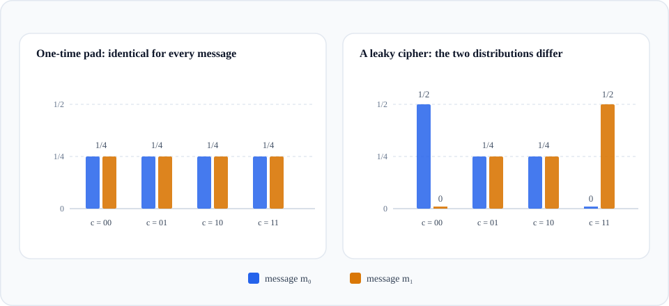

# 2.1 Perfect Secrecy and the One-Time Pad

Every cipher in Chapter 1 was broken the same way: encryption left a trace of the plaintext in the ciphertext, and the attacker measured the trace. A more elaborate scramble would only postpone the measurement. What was missing was a definition sharp enough to prove that no trace is left at all, and Claude Shannon supplied it in 1949 in <cite>Communication Theory of Secrecy Systems</cite>, together with the first proof that a particular cipher meets it. The cipher was already thirty years old: the **one-time pad**.

The pad itself predates the proof. In 1917 Gilbert Vernam, at AT&T, built a telegraph cipher that combined the message with a key supplied on a paper tape; the step that turns the idea into a one-time pad, a key that is truly random, as long as the message, and never reused, is credited to Joseph Mauborgne. The design is fast and obviously correct, and for three decades its security rested on intuition. Shannon proved that the intuition is right, and that no cipher with a shorter key can be.

## 2.1.1 The one-time pad

Every statement in this chapter quantifies over the key space, the message space, and the ciphertext space, so the definition from Section 1.2 is worth restating in full:

::: theorem Definition (cipher)
A **cipher** (or **encryption scheme**) $\mathcal{E} = (E, D)$ defined over $(\mathcal{K}, \mathcal{M}, \mathcal{C})$ is a pair of efficient algorithms:

- $E : \mathcal{K} \times \mathcal{M} \to \mathcal{C}$, the encryption algorithm, and
- $D : \mathcal{K} \times \mathcal{C} \to \mathcal{M}$, the decryption algorithm,

such that for every key $k \in \mathcal{K}$ and every message $m \in \mathcal{M}$,

$$D\bigl(k,\, E(k, m)\bigr) = m.$$

Encryption may be randomized; decryption is always deterministic. The sets $\mathcal{K}$, $\mathcal{M}$, and $\mathcal{C}$ are the **key space**, **message space**, and **ciphertext space**.
:::

The one-time pad fixes a length $n$ and takes

$$\mathcal{K} = \mathcal{M} = \mathcal{C} = \{0,1\}^n, \qquad E(k, m) := k \oplus m, \qquad D(k, c) := k \oplus c .$$

That is the entire design. With $m = \texttt{0110111}$ and $k = \texttt{1011010}$ the ciphertext is $\texttt{1101101}$, and XORing the key back in returns the message. Correctness is one line of algebra, using only the laws collected in Section 1.3.7:

$$D\bigl(k, E(k, m)\bigr) = k \oplus (k \oplus m) = (k \oplus k) \oplus m = 0^n \oplus m = m .$$

Encryption and decryption are the same operation and both are bitwise, so the pad costs one XOR per bit and runs at memory speed, which is as cheap as encryption gets. The cost sits in the key. A pad is as long as the message it protects, so a 1 GB file needs close to $2^{33}$ bits of key, about $2^{26}$ times the 128 bits of an AES key, and all of those bits must reach Bob on a channel that is already secret. That is the practical obstacle, and it is why the pad is reserved for traffic whose keys can be distributed in advance.

The obvious objection: if Alice and Bob can move a 1 GB key, they could move the 1 GB message the same way. The difference is timing and reuse. A key can be agreed on years in advance, before the message exists, and a given key protects exactly one message, so the channel that later carries the message can be completely public. The cost remains: every bit of protected traffic consumes a bit of pre-distributed secret, and most systems cannot afford it.

::: details Quiz: You are given a message $m$ and its one-time-pad ciphertext $c$. Can you compute the key?
Yes, immediately: $k = m \oplus c$, because $c = k \oplus m$. This is not a break, since the attacker of our threat model never sees $m$; and because the key is used once, the recovered key protects nothing else. It does show that the pad offers no key-recovery strength once any plaintext is known, which is the first hint that “the attacker cannot find the key” is the wrong definition of security.
:::

## 2.1.2 What should “secure” mean?

Two definitions suggest themselves, and both fail. Seeing why tells us what the right definition must say.

**Attempt 1: the attacker cannot recover the key.** This is neither sufficient nor necessary. It is not sufficient because a cipher can simply ignore its key: define $E(k, m) := m$ and $D(k, c) := c$ over any nonempty key space. Correctness holds, no key can be recovered from $c$ alone because the ciphertext is the message, and the attacker has lost nothing. It is not necessary because of the quiz above: for the one-time pad, anyone who knows a message and its ciphertext recovers the key at once, yet the pad is as secure as a cipher can be.

**Attempt 2: the attacker cannot recover the whole message.** For $n \ge 2$ and a one-bit key, define

$$E(k, m) := \bigl(m_1, \dots, m_{n-1},\, m_n \oplus k\bigr),$$

and decrypt by re-XORing the last bit. The attacker reads $n-1$ bits of $m$ straight off the ciphertext and cannot produce the last one, so she cannot recover *all* of $m$. She has lost a single bit and learned everything else.

Both attempts fail in the same way: they name one task the attacker must fail at, instead of a quantity she must not learn. An attacker who cannot compute $m$ may still know that $m$ is one of two messages, or that it begins with `FROM`, or that its first two letters repeat, and each of those facts can be worth more than the computation she is denied. Chapter 1 exploited exactly such facts.

Shannon’s move was to forbid every fact at once: the ciphertext must leave the attacker’s knowledge of the message exactly where it was. Not “$m$ is hard to compute” but “$c$ is independent of $m$.”

## 2.1.3 Perfect secrecy

Fix a message and think of the ciphertext as a random variable, randomized by the key. If the cipher is any good, the distribution of that variable should not depend on which message was encrypted: the same histogram for $m_0$ as for $m_1$. If the two histograms differ, then some ciphertext is more likely under one message than under the other, and seeing it shifts the attacker’s belief. Perfect secrecy is the statement that no such shift exists, for any pair of messages and any ciphertext.

<figure class="main-figure">
  
  <figcaption class="image-caption">Perfect secrecy compares the two bars at each ciphertext, not the heights across ciphertexts: the pad’s uniform heights are a property of the pad, not of the definition.</figcaption>
</figure>

::: theorem Definition (perfect secrecy)
Let $\mathcal{E} = (E, D)$ be a cipher over $(\mathcal{K}, \mathcal{M}, \mathcal{C})$ whose messages all have the same length $n$. Draw the key uniformly, $k \xleftarrow{\mathrm{R}} \mathcal{K}$. Then $\mathcal{E}$ has **perfect secrecy** (also called *perfect security*) if for all $m_0, m_1 \in \mathcal{M}$ and all $c \in \mathcal{C}$,

$$\Pr\bigl[E(k, m_0) = c\bigr] = \Pr\bigl[E(k, m_1) = c\bigr].$$
:::

Three points about the definition are easy to miss.

- The probability is over the uniform key only. The message is fixed, not random; distributions on $\mathcal{M}$ appear when we interpret the definition, not when we state it.
- The equality is required for *every* ciphertext, including strings that no key produces. There both sides are zero, and the condition holds trivially.
- Messages are all of one length, and the restriction is not cosmetic. If the ciphertext is as long as the plaintext, as in the natural variable-length pad, then the length of $c$ reveals the length of $m$: with a secret key $k \in \{0,1\}^L$, a one-bit message leaves a one-bit ciphertext that matches with probability $1/2$, while a two-bit message can never produce a one-bit ciphertext. The fix is padding: make all messages the same length, then encrypt.

With that in hand, the definition has an equivalent form that is easier to remember. Give the message any distribution independent of the key, and let $C := E(k, M)$. Then

$$\Pr[M = m \mid C = c] = \frac{\Pr[C = c \mid M = m]\,\Pr[M = m]}{\Pr[C = c]} = \Pr[M = m],$$

because the factor $\Pr[C = c \mid M = m] = \Pr[E(k, m) = c]$ is the same for every $m$. Seeing a ciphertext does not update any belief about the message: $C$ and $M$ are independent random variables. Since the argument works for every prior, no attacker, however powerful, can extract a fact about $m$ that she did not already have.

Perfect secrecy is an **information-theoretic** notion. It quantifies over all attackers with unlimited time and memory, and over all properties of the message at once, so it rules out every ciphertext-only attack rather than a list of known ones.

## 2.1.4 Counting keys

The definition compares probabilities, but every probability here is a fraction of the key space, and fractions are easier to count than to argue about.

::: theorem Lemma (probability is a key count)
For fixed $m \in \mathcal{M}$ and $c \in \mathcal{C}$,

$$\Pr_{k \leftarrow \mathcal{K}}\bigl[E(k, m) = c\bigr] = \frac{\bigl|\{\, k \in \mathcal{K} : E(k,m) = c \,\}\bigr|}{|\mathcal{K}|}.$$
:::

The key is uniform, so each of the $|\mathcal{K}|$ keys has probability $1/|\mathcal{K}|$, and the event happens for exactly the keys counted in the numerator.

::: theorem Theorem (counting characterization)
A cipher over $(\mathcal{K}, \mathcal{M}, \mathcal{C})$ is perfectly secret if and only if for every $c \in \mathcal{C}$ there is a number $N_c$ such that

$$\bigl|\{\, k \in \mathcal{K} : E(k, m) = c \,\}\bigr| = N_c \qquad \text{for all } m \in \mathcal{M}.$$

(The number may depend on the ciphertext, but not on the message.)
:::

Proof. For the forward direction, fix $c$ and any message $m_0$, and let $N_c$ be the count for $m_0$. Perfect secrecy says that every other $m$ gives the same probability, so by the lemma it gives the same count. For the converse, if the counts agree then dividing by $|\mathcal{K}|$ makes the probabilities agree for every pair $m_0, m_1$. ∎

This is the form in which perfect secrecy is checked in practice: for each ciphertext, count how many keys lead to it from each message. The count may vary with $c$. It may not vary with $m$.

## 2.1.5 The one-time pad is perfectly secret

::: theorem Theorem (one-time pad)
The one-time pad over $(\{0,1\}^n, \{0,1\}^n, \{0,1\}^n)$ is perfectly secret.
:::

Proof. Fix $m$ and $c$. We need the number of keys $k$ with $k \oplus m = c$.

::: details Quiz: How many one-time pad keys map a given message $m$ to a given ciphertext $c$?
Exactly one. XORing both sides of $k \oplus m = c$ by $m$ gives $k = m \oplus c$, a unique solution. So the count is $1$ for every message and every ciphertext, and the counting characterization applies with $N_c = 1$. ∎
:::

The proof says more than the definition needs. Since the count is $1$ whatever $m$ is, every ciphertext is equally likely under every message:

$$\Pr\bigl[E(k,m) = c\bigr] = \frac{1}{2^n}.$$

The ciphertext is uniform on $\{0,1\}^n$, whatever Alice sent: the eavesdropper sees a string that looks exactly like $n$ fair coin flips. This is the masking lemma of Section 1.3.7 applied to a cipher.

For $n = 2$ the whole cipher fits in a table, with keys as rows and messages as columns:

| | $m = 00$ | $m = 01$ | $m = 10$ | $m = 11$ |
|---|---|---|---|---|
| $k = 00$ | `00` | `01` | `10` | `11` |
| $k = 01$ | `01` | `00` | `11` | `10` |
| $k = 10$ | `10` | `11` | `00` | `01` |
| $k = 11$ | `11` | `10` | `01` | `00` |

Read it by column: each column contains each ciphertext exactly once, so the count is $1$ from any message to any ciphertext. Each row also visits every ciphertext exactly once, which is the same fact seen from the key’s side: for a fixed key, the map $m \mapsto E(k, m)$ is a permutation of $\{0,1\}^n$.

## 2.1.6 The price of perfect secrecy

Perfect secrecy is strong enough to determine the size of the key, and the reason is counting. Take a ciphertext $c$ that some message does produce. A key produces $c$ from only one message, so at most $|\mathcal{K}|$ messages can lead to $c$. Perfect secrecy demands that $c$ be equally likely under every message, hence that every message lead to it; with fewer keys than messages there are not enough keys for that.

::: theorem Theorem (Shannon’s theorem)
If a cipher over $(\mathcal{K}, \mathcal{M}, \mathcal{C})$ has perfect secrecy, then $|\mathcal{K}| \ge |\mathcal{M}|$.
:::

Proof. Suppose instead that $|\mathcal{K}| < |\mathcal{M}|$. Choose any $m_0 \in \mathcal{M}$ and any $k_0 \in \mathcal{K}$, and set $c := E(k_0, m_0)$; then $m_0$ is consistent with $c$, since $k_0$ maps to it. Let

$$S := \{\, D(k_1, c) : k_1 \in \mathcal{K} \,\}$$

be the set of messages that some key decrypts $c$ to. Because $|S| \le |\mathcal{K}| < |\mathcal{M}|$, some message $m_1$ lies outside $S$. No key maps $m_1$ to $c$: if a key $k_1$ did, correctness would give

$$D(k_1, c) = D\bigl(k_1, E(k_1, m_1)\bigr) = m_1 \in S,$$

a contradiction. Hence $\Pr[E(k, m_0) = c] \ge 1/|\mathcal{K}| > 0$ while $\Pr[E(k, m_1) = c] = 0$, the two probabilities differ, and the cipher is not perfectly secret. ∎

Note what the proof does not assume. The attacker never recovers $m$ and never performs cryptanalysis; she only uses the fact that a ciphertext is consistent with at most $|\mathcal{K}|$ messages. Perfect secrecy fails because the set of possible messages is larger than the key can cover, and an attacker with unlimited time can see the uncovered part.

For $n$-bit messages, $|\mathcal{M}| = 2^n$, so a perfectly secret cipher needs $|\mathcal{K}| \ge 2^n$: a key of at least $n$ bits, one bit of key per bit of message. The one-time pad meets the bound with equality and is therefore optimal among perfectly secret ciphers; no scheme with the same message space can use a shorter key. Conversely, a cipher with a 128-bit key cannot be perfectly secret for messages longer than 128 bits, whatever its internal design. To send a one-gigabyte file this way, Alice and Bob would have to share a one-gigabyte key in advance.

The theorem is a statement about information, not about effort: no cipher design avoids it. The only way around it is to change the definition, so that only feasible adversaries count and any advantage they gain must be negligible. That relaxation is where computation enters cryptography, and it is where the rest of Chapter 2 goes.

 One limit of the model matters before moving on: perfect secrecy covers a single message under a single use of the key, and says nothing about an attacker who can alter the ciphertext in transit. Both are taken up later.
