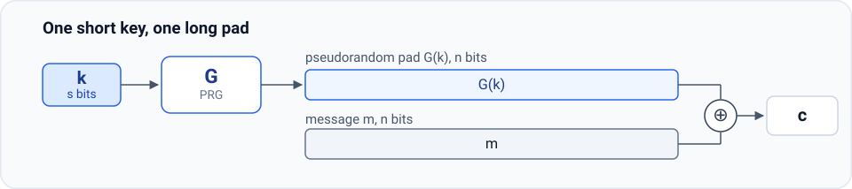

# 2.2 Stream Ciphers and Pseudorandom Generators

Section 2.1 showed that perfect secrecy costs one bit of key per bit of message, and the one-time pad meets that cost exactly. The way out is not a cleverer cipher but a weaker demand on the pad. The pad does not have to be random; it has to be indistinguishable from random for anyone who does not hold the seed that produced it. A short key is stretched into a long pad by a public deterministic algorithm, and the pad is then consumed exactly as in the one-time pad.

The construction is a **stream cipher**, the stretching algorithm is a **pseudorandom generator**, and everything about the cipher’s security reduces to a property of that algorithm. This section defines both objects, isolates the minimum the generator must satisfy, and explains why the generators that ship with programming languages do not satisfy it.

## 2.2.1 Making the one-time pad practical

Fix a message length $n$ and a much shorter key length $s$. A pseudorandom generator maps an $s$-bit **seed** to an $n$-bit string, $G : \{0,1\}^s \to \{0,1\}^n$. The stream cipher built from $G$ keeps the one-time pad’s arithmetic and replaces the uniform pad by the generator’s output:

$$
\begin{aligned}
&\mathcal{K} = \{0,1\}^s, \qquad \mathcal{M} = \mathcal{C} = \{0,1\}^n, \\
&E(k, m) := m \oplus G(k), \qquad D(k, c) := c \oplus G(k).
\end{aligned}
$$

Both algorithms recompute the same pad from the same key, so correctness is again one line of XOR algebra:

$$D\bigl(k, E(k,m)\bigr) = \bigl(m \oplus G(k)\bigr) \oplus G(k) = m .$$

<figure class="main-figure">
  
  <figcaption class="image-caption">The pad is as long as the message, but the secret that determines it is not. That asymmetry is the gain, and also the reason the cipher can no longer be perfectly secret.</figcaption>
</figure>

With $s = 128$ and $n = 2^{33}$, a 16-byte key protects a gigabyte, an expansion by a factor of $2^{26}$. The key still has to reach Bob over a channel Eve does not control, but it is now small enough to be pre-positioned or wrapped in another key, neither of which was possible for a pad the size of the message. The name is descriptive: the generator emits a stream of pad bits, and encryption consumes one of them per message bit as the message streams past.

Three facts shape everything that follows.

**A stream cipher cannot have perfect secrecy.** The key space has $2^s$ elements and the message space has $2^n$, with $s < n$; Shannon’s theorem (Section 2.1.6) requires $|\mathcal{K}| \ge |\mathcal{M}|$, so no choice of $G$ makes this cipher perfectly secret. The tempting answer “yes, if the generator is secure” mixes up the two definitions: a secure generator buys computational security, never perfect secrecy.

**A new definition of security is needed.** Perfect secrecy asked for too much; the right notion will bound the advantage of an *efficient* attacker and allow a negligible failure probability. That definition is the work of the later sections of this chapter.

**Security now rests entirely on $G$.** With the pad, the key was uniform and the proof used nothing else. Here the pad is the output of an algorithm that Alice, Bob, and Eve all know, and the only secret input is $k$. If the output can be distinguished from random, or extended from a prefix, the cipher inherits the defect. A weak generator does not weaken the cipher a little; as Section 2.2.3 shows, it breaks the cipher.

## 2.2.2 What a pseudorandom generator is

A generator concentrates randomness: it takes $s$ truly random bits and produces $n$ bits that must be usable as if they were random, for every purpose an attacker might put them to. The economy is real only if $n$ is much larger than $s$; the quality is real only if no efficient algorithm can tell the output from a uniform string.

::: theorem Definition (pseudorandom generator)
A **pseudorandom generator** (PRG) is an efficient deterministic algorithm $G : \{0,1\}^s \to \{0,1\}^n$ with $n \gg s$, such that for a uniformly random seed $k \xleftarrow{\mathrm{R}} \{0,1\}^s$ the string $G(k)$ is **computationally indistinguishable** from a uniform $n$-bit string: no efficient algorithm behaves noticeably differently when handed one rather than the other.
:::

The indistinguishability clause is the hard part, and it is made precise in Section 2.5. The two structural clauses already carry most of the intuition.

- **Deterministic.** Bob must reconstruct exactly the pad Alice used, and the channel carries nothing to help him. Any randomness inside $G$ would either have to be transmitted, which defeats the purpose, or reproduced, which is impossible. All the randomness of the construction sits in the seed; $G$ itself is fixed, public, and has none.
- **Expanding.** $n \gg s$ is what makes the construction an improvement over the pad. A generator with $n = s$ would buy nothing, and one with $n < s$ would throw key material away.

Note what is *not* required. The definition does not ask that the seed be hard to recover, that the output avoid any particular pattern, or that any single statistic take its expected value. It asks one thing of the whole string: that no efficient test separate it from uniform.

## 2.2.3 A pad must not be predictable

Here is what “indistinguishable from random” has to rule out at a minimum. An SMTP message begins with the five characters `From:` and the space after them, six bytes that the sender cannot avoid and the attacker knows. XOR those six bytes into the first six bytes of the ciphertext and the attacker has recovered the first 48 bits of the pad, without touching the key. If 48 bits of pad determine the rest, one known header decrypts the entire message: the attacker predicts the pad forward, XORs it into the ciphertext, and reads the plaintext off.

The lesson generalizes to a single bit. An attacker who knows the first $i$ bits of a message knows the first $i$ bits of the pad; if she can compute bit $i+1$ of the pad from those, she recovers bit $i+1$ of the message, and with it one more pad bit, and so on to the end. A pad that can be extended from a prefix is not a pad.

::: theorem Definition (predictable generator)
$G : \{0,1\}^s \to \{0,1\}^n$ is **predictable at position $i$** if there is an efficient algorithm $A$ with

$$\Pr_{k \leftarrow \{0,1\}^s}\Bigl[\, A\bigl(G(k)_{1..i}\bigr) = G(k)_{i+1} \,\Bigr] \;\ge\; \frac{1}{2} + \varepsilon$$

for some non-negligible $\varepsilon$, where $G(k)_{1..i}$ is the first $i$ bits of the output. $G$ is **unpredictable** if it is not predictable at any position $i \in \{0, \dots, n-1\}$.
:::

The $1/2$ is a baseline, not a technicality. An algorithm that ignores its input and outputs a fair coin guesses the next bit correctly half the time, so the definition asks for a *consistent* edge of $\varepsilon$ over guessing, obtained from the prefix alone, in feasible time. A generator with such an edge is useless in a stream cipher:

::: theorem Theorem (predictability breaks the cipher)
If $G$ is predictable at position $i$, then an attacker who knows the first $i$ bits of an encrypted message can recover all of it.
:::

Proof. The attacker XORs the known message prefix into the ciphertext and holds $G(k)_{1..i}$. The predictor returns $G(k)_{i+1}$, and XORing that value into the next ciphertext bit yields the next message bit. She now knows the first $i+1$ bits of the message, hence of the pad, so the same procedure produces bit $i+2$, and so on to the end. ∎

Note the shape of the argument: the attacker never attacks $G$ mathematically. She exploits a known prefix of the plaintext, which real protocols supply by the byte, and iterates one prediction into a full break. That is why unpredictability is treated as the minimum for a generator, and why the definition quantifies over every position: one vulnerable position is enough.

::: details Quiz: A generator $G$ has the property that, for every seed, the XOR of all $n$ bits of its output is $1$. Is it predictable?
Yes, at position $n-1$: given the first $n-1$ bits, the last bit is forced, because it must make the total XOR equal to $1$. The predictor needs no key and no computation beyond one XOR of the prefix, and it is right every time, an edge of $\varepsilon = 1/2$.
:::

## 2.2.4 Negligible and non-negligible

Two words carry weight in the definitions so far. *Efficient* means polynomial time in the size of the objects involved, and that is all it will ever mean here. *Non-negligible* is defined differently by different communities: practitioners treat it as a property of a single number, and the formal definitions treat it as a property of a function. Both readings are worth having; the first gives the numbers to remember, the second is the official one.

**In practice.** Take $\varepsilon$ as a fixed number. A probability of $2^{-30}$ is non-negligible: a key that protects a gigabyte sees about $2^{30}$ bytes of traffic, and an event with probability $2^{-30}$ per byte occurs at least once with probability

$$1 - \bigl(1 - 2^{-30}\bigr)^{2^{30}} \approx 1 - e^{-1} \approx 0.63,$$

which is a coin flip, not a safety margin. A probability of $2^{-80}$ is negligible: at a gigabyte per second, waiting for one such event takes $2^{80}/2^{30} = 2^{50}$ seconds, about 36 million years, longer than any key is used.

**In theory.** The scalar answer depends on the deployment it was computed for: change the key, change the amount of traffic, and the verdict can move. A definition should not hang on one deployment. In the rigorous view a generator is not one algorithm but a *family* $G_\lambda$, one for each value of a **security parameter** $\lambda$, with seed and output lengths growing as $\lambda$ grows. Every primitive defined later is a family in the same way. An adversary attacks one member at a time, so her edge is a function $\varepsilon(\lambda)$ rather than a number, and the definition of Section 2.2.3, made precise, reads: $G_\lambda$ is predictable if some adversary running in time polynomial in $\lambda$ reaches probability $\frac12 + \varepsilon(\lambda)$ at some position, for a non-negligible $\varepsilon(\lambda)$.

::: theorem Definition (negligible, non-negligible)
Let $\varepsilon : \mathbb{Z}_{\ge 0} \to \mathbb{R}_{\ge 0}$. Then $\varepsilon$ is **negligible** if for every $d > 0$ there is a $\lambda_d$, depending on $d$, such that

$$\varepsilon(\lambda) \le \frac{1}{\lambda^{d}} \qquad \text{for all } \lambda \ge \lambda_d,$$

and $\varepsilon$ is **non-negligible** if it is not negligible; equivalently, if there is a $d > 0$ such that

$$\varepsilon(\lambda) \ge \frac{1}{\lambda^{d}} \qquad \text{for infinitely many } \lambda.$$
:::

Unpacked: negligible means beating every inverse polynomial eventually, and all degrees at once. $\varepsilon(\lambda)$ must drop below $1/\lambda$ for all $\lambda \ge \lambda_1$, below $1/\lambda^{2}$ for all $\lambda \ge \lambda_2$, below $1/\lambda^{10}$ for all $\lambda \ge \lambda_{10}$, and so on, each degree carrying its own cutoff. A few examples make the verdicts concrete:

| $\varepsilon(\lambda)$ | verdict |
|---|---|
| $2^{-\lambda}$ | negligible: exponential decay beats every inverse polynomial |
| $1/\lambda^{1000}$ | non-negligible: take $d = 1000$ |
| $2^{-\lambda}$ at odd $\lambda$, $\lambda^{-1000}$ at even $\lambda$ | non-negligible: the even $\lambda$ alone satisfy the definition |

The last two rows look wrong from the practitioner’s seat. At $\lambda = 2^{10}$ the value $\lambda^{-1000} = 2^{-10000}$ is far below anything a computer can exploit, and a function that is exponentially small on half its inputs sounds safely small. The definition still calls both non-negligible, and that is a design choice, not an oversight: it refuses to make promises about the sizes it has not bounded, and an inverse-polynomial value, however rare, is too large to build a real system on. What the definition guarantees is asymptotic shape, and asymptotic shape is what makes security statements about entire families expressible and composable; the practitioner’s scalars are for reading concrete parameters afterward.

One closure property does most of the work in the proofs that follow: a polynomial factor does not spoil negligibility. An efficient adversary can repeat an experiment polynomially many times, or attack polynomially many keys, and each such multiplication scales her edge by a polynomial; if $\varepsilon$ is negligible and $p$ is any polynomial, then $p(\lambda)\,\varepsilon(\lambda)$ is negligible as well.

Two conventions for the rest of this tutorial. The parameter $\lambda$ stays out of the notation: $G : \{0,1\}^s \to \{0,1\}^n$ means the family with one choice of $s$ and $n$ per $\lambda$. And the two adjectives are read coarsely: exponentially small counts as negligible, and anything at least inverse-polynomial counts as non-negligible.

## 2.2.5 Generators that look random and are not

Statistical quality is easy to fake, and the generators shipped with programming languages fake it well. Both examples below pass the elementary tests and neither can be used for a key.

**Linear congruential generators.** Pick integers $a$, $b$ and a prime modulus $p$, and set $r_0 := k$. Each step applies

$$r_i := (a\, r_{i-1} + b) \bmod p,$$

and the generator outputs a few bits of $r_i$, discarding the rest. The number $r_i$ is the generator’s *state*, what it carries from step to step, and here the whole state is a single machine *word*, one register-sized integer. The output passes the elementary tests: the bits are balanced, the period is long, and single-bit and pair statistics look right. Yet at every step the same linear transformation is applied to that one word, and just a few output samples make the rest of the sequence easy to predict. It is a generator for simulation, where the goal is that the numbers be spread out, not for cryptography, where the goal is that nothing be inferable.

**The C library’s `random()`.** The glibc implementation keeps a 31-word state and updates it by

$$r_i := (r_{i-3} + r_{i-31}) \bmod 2^{32}, \qquad \text{output } \lfloor r_i / 2 \rfloor,$$

a lagged Fibonacci recurrence. The new word $r_i$ is itself a state word: it is kept in the array and enters the sums that produce $r_{i+3}$ and $r_{i+31}$ two steps and thirty-one steps later. What the user sees, however, is $\lfloor r_i / 2 \rfloor$: dividing by two and rounding down erases the low bit of $r_i$ and hands over the other 31 bits. Thirty-one consecutive outputs therefore cover the whole 31-word state, each word known except for its single low bit: the missing bits are 31 in all, and there are $2^{31}$ ways to fill them. An attacker tries each filling, generates forward from the resulting state, and keeps only the candidates whose predicted outputs match the ones observed; a handful of outputs past the window suffices to pin down a unique state. With the state in hand, every later output is known. Kerberos version 4 drew its session keys from this generator, and the choice was later exploited.

The general lesson is that a statistical test examines the output as a bag of bits, while an attacker examines the algorithm that produced it. The standard checks measure properties the generator happens to have: about as many zeros as ones, the pattern `00` in about a quarter of the positions, and the like; security has to hold against tests designed with the generator’s structure in mind. This is why Section 2.5 defines the security of a generator by quantifying over all efficient tests rather than listing a few, and why any generator not designed and analyzed for the purpose should be assumed predictable.
