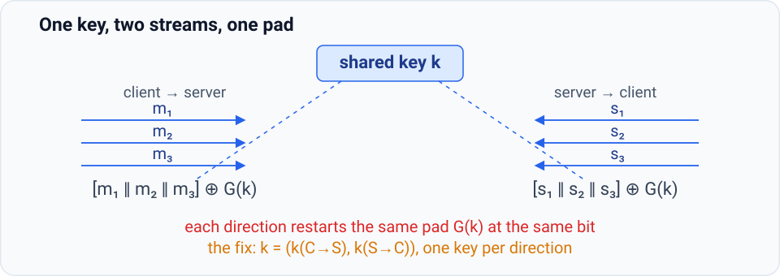
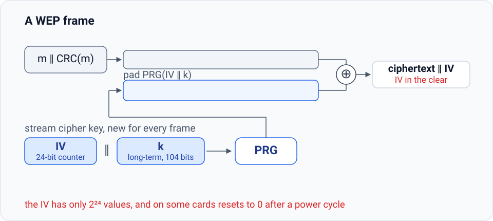
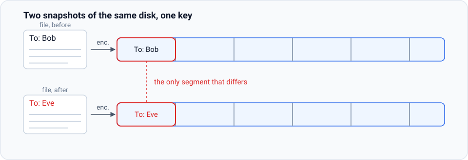
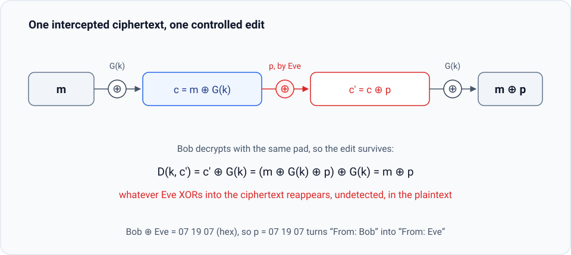

# 2.3 Attacks on Stream Ciphers and the One-Time Pad

The guarantees proved so far live inside a narrow model: one message, one use of the key, and an eavesdropper who only reads. That model is what makes the one-time pad perfectly secret, and it is what the security definitions later in this chapter will keep. Both guarantees evaporate the moment usage steps outside the model. Two departures recur in deployed systems. Reuse the pad and every message it protects leaks; let the attacker touch the ciphertext and she edits the plaintext without ever learning the key. This section takes up both attacks, and the real systems that fell to them.

## 2.3.1 The two-time pad

The pad is called “one-time” because it encrypts a single message. Suppose the same pad encrypts two.

$$c_1 \leftarrow m_1 \oplus G(k), \qquad c_2 \leftarrow m_2 \oplus G(k).$$

An eavesdropper who intercepts both ciphertexts does the first thing that comes to mind: she XORs them.

$$c_1 \oplus c_2 \;=\; \bigl(m_1 \oplus G(k)\bigr) \oplus \bigl(m_2 \oplus G(k)\bigr) \;=\; m_1 \oplus m_2 .$$

The pad cancels, and what survives is not a random-looking string: it is the XOR of two plaintexts. That object leaks far more than it seems to. English text, and its ASCII encoding, carry enough redundancy that from $m_1 \oplus m_2$ an attacker can recover both messages in the clear without much work at all.

Notice what the attack does *not* use. It never touches $G$: it does not matter whether the pad is the output of a secure generator, a weak one, or a genuinely random pad. The two-time pad breaks the one-time pad itself. The failure is in how the key was used, not in how the pad was made. Hence the rule that governs every stream cipher:

**A stream cipher key may be used once.** Encrypting $m_1, m_2, m_3$ as one concatenated stream $m_1 \| m_2 \| m_3$ (the double bar $\|$ denotes concatenation: the bits of $m_1$, followed end to end by the bits of $m_2$, then of $m_3$) under a single key is a single encryption of a single message, and it is perfectly fine; what is fatal is restarting the pad.

## 2.3.2 Reuse in deployed systems

**Project Venona.** In the early 1940s the Soviet Union encrypted diplomatic traffic with one-time pads whose keys were produced by hand, by throwing dice. Generating the pads was laborious, and discarding a pad after one message seemed wasteful, so pads were used for two messages and sometimes more. Beginning in 1946, US and British intelligence, working from intercepted ciphertext pairs, applied exactly the computation above and decrypted on the order of 3,000 messages over the following quarter century. Nothing about the pad design was broken; the pad had simply been used twice.

**PPTP.** Windows NT’s Point-to-Point Tunneling Protocol lets a client and a server exchange encrypted messages under a shared key $k$. The protocol treats all messages from the client as one stream and all messages from the server as one stream:

$$\bigl(m_1 \| m_2 \| m_3\bigr) \oplus G(k), \qquad \bigl(s_1 \| s_2 \| s_3\bigr) \oplus G(k).$$

Each direction on its own is a legitimate single use of the pad. The flaw is between them: both streams are generated from the same seed, so both are masked by the same pad starting at the same bit, and the XOR of the two streams falls out of the XOR of the two ciphertexts. A single conversation carried its own two-time pad.

<figure class="main-figure">
  
</figure>

The lesson is not to avoid stream ciphers but to count pad restarts. The shared key $k$ should really be a pair, $k = (k_{C \to S},\, k_{S \to C})$: one key to encrypt client to server, one to encrypt server to client, both known to both sides. Neither direction ever restarts its pad, and the two pads are independent.

## 2.3.3 WEP: cycling counters and related keys

Wi-Fi’s original encryption layer, the one built into 802.11b and called WEP, is a case study in how to reproduce the two-time pad while trying to avoid it. A client and an access point share a long-term key $k$, typically 104 bits. To transmit a frame $m$, the sender appends a checksum $\text{CRC}(m)$, encrypts $m \| \text{CRC}(m)$ with a stream cipher whose seed is the concatenation $\text{IV} \| k$, and sends the IV along with the ciphertext in the clear; the receiver, holding $k$, re-derives the pad and decrypts. The IV is a 24-bit string, a counter that starts at zero and increments by one for every frame.

<figure class="main-figure">
  
  <figcaption class="image-caption">The checksum is a redundancy code; it plays no role in the attacks below.</figcaption>
</figure>

The designers knew the rule of Section 2.3.1. A stream cipher key is good for one message, so they changed the key for every frame by prepending the counter. Two failures followed.

**The counter cycles.** The IV has $2^{24}$ values, about 16.7 million. A busy network exhausts them, the counter wraps, and the pair $(\text{IV}, k)$ that produced the pad reappears: two different frames, one pad, the two-time pad, and the long-term key $k$ never changes. Worse, on many cards the IV resets to zero at a power cycle, so the key $0 \| k$ reappears every time the card restarts, with nothing to prevent the repeat.

**The keys are related.** Even before any wrap, the keys were never independent. Frame 1 uses $1 \| k$, frame 2 uses $2 \| k$, and so on: every key shares the same 104-bit suffix, and only the first 24 bits move. A generator is defined secure on a uniform seed, and these seeds form a narrow, structured set, not a uniform one. The generator WEP used, RC4, does not survive them: in 2001 Fluhrer, Mantin and Shamir showed that after roughly $10^{6}$ frames of traffic the long-term key $k$ can be recovered outright, and later refinements bring the requirement down to about 40,000 frames, a matter of minutes of passive listening. WEP fails twice over: repeated IVs give the two-time pad, and related keys give full key recovery without waiting for any repeat. It provides no security at all.

The security definitions of Sections 2.5 and 2.6 will make the second failure precise: when we analyze a construction whose keys are related in this way, the proof of security simply cannot go through. Changing the key “a little” is not changing the key.

What should WEP have done? Treating the whole exchange as one long stream under one key removes the problem by construction: the first segment of the pad encrypts frame 1, the second segment frame 2, and the pad never restarts. If per-frame keys are wanted instead, they should be derived rather than counter-prefixed: feed $k$ to a PRG, chop the output into segments, and give each frame its own segment as its key. The segments then look like independent random keys, and a generator that is secure on random seeds stays secure on them. In practice the fix was neither: WEP was replaced by stronger encryption (WPA2), not repaired.

## 2.3.4 Stream ciphers on disk

One more setting where reuse is unavoidable, and instructive. Suppose a disk encrypts files with a stream cipher under a fixed key. A file begins with the words `To: Bob` and is saved; later the user opens it, changes the address to `To: Eve`, and saves again.

<figure class="main-figure">
  
  <figcaption class="image-caption">The words inside the track mark file positions, not readable content: the ciphertext itself is opaque.</figcaption>
</figure>

Two things go wrong at once. First, the two versions of the file are two messages encrypted under the same pad: a two-time pad between a file and its own revision, with all the consequences of Section 2.3.1. Second, the pad is positional: bit $i$ of every version is masked by bit $i$ of the same pad, so unchanged text gives unchanged ciphertext. An attacker holding a snapshot of the disk before the edit and another after it sees that everything is identical except one short segment, and learns exactly where the change was made, and plausibly what it was. A one-word edit should change the whole block, or the whole file; a stream cipher guarantees that it changes almost nothing.

Disk encryption, then, is not a setting for stream ciphers. The general rules this tour leaves behind are short enough to memorize:

- Never use a stream cipher key, or a pad, more than once.
- Network traffic: negotiate a fresh key for every session (as TLS does), and use one key per direction within a session.
- Disk encryption: use something other than a stream cipher.

## 2.3.5 Malleability

Every attacker so far was an eavesdropper. The threat model of Chapter 1 allowed more: the channel is not just observed but modified. The pad and the stream cipher hand the attacker that power for free. Let

$$c = m \oplus G(k)$$

be an intercepted ciphertext, and let the attacker replace it with $c' := c \oplus p$ for any string $p$ of her choosing. Decryption applies the same pad to the modified ciphertext:

$$D\bigl(k, c'\bigr) = c' \oplus G(k) = \bigl(c \oplus p\bigr) \oplus G(k) = m \oplus p.$$

Nothing flags the tampering, and its effect is exactly known: whatever the attacker XORs into the ciphertext comes out XORed into the plaintext. She never learns $m$, and she does not need to.

<figure class="main-figure">
  
</figure>

::: theorem Definition (malleable)
A cipher is **malleable** if an attacker who intercepts a ciphertext $c = E(k, m)$ can transform it into a different ciphertext $c'$ that decrypts to a plaintext whose relation to $m$ she controls, without knowing $k$ or $m$. The one-time pad, and every stream cipher, is malleable: $c \oplus p$ decrypts to $m \oplus p$.
:::

Here is what malleability buys. A message begins with the header `From: Bob`; the attacker wants the recipient to read `From: Eve`. She holds no key and cannot encrypt a message of her own from scratch, but she knows the difference between the two names. In ASCII, writing the byte values in hexadecimal,

$$
\begin{aligned}
\texttt{B} \oplus \texttt{E} &= \texttt{42} \oplus \texttt{45} = \texttt{07}, \\
\texttt{o} \oplus \texttt{v} &= \texttt{6f} \oplus \texttt{76} = \texttt{19}, \\
\texttt{b} \oplus \texttt{e} &= \texttt{62} \oplus \texttt{65} = \texttt{07}.
\end{aligned}
$$

So she XORs `07 19 07` into the ciphertext at the offset of the name, and the recipient decrypts `From: Eve`. A ciphertext saying something she chose, in a message she never read, now exists, obtained by editing a ciphertext she overheard.

The cipher has kept its promise, the one that matters to an eavesdropper: the ciphertext reveals nothing about the plaintext. What it never promised, and cannot deliver, is that the ciphertext is the message the sender sent. Confidentiality without **integrity** is half a guarantee, and for the traffic that real systems carry, the missing half is the one that hurts. Integrity arrives with message authentication codes in Chapter 5, and encryption that provides both properties at once, in Chapter 6.

---

Not one attack in this section touched the generator: reuse and tampering break a truly random pad as easily as a pseudorandom one. The failures are failures of use. But WEP left a second, uncomfortable hint: its generator RC4 fell to key-recovery attacks of its own, so the designs themselves are fair game too. Section 2.4 looks at the stream ciphers the world actually shipped, from RC4 and the hardware generators of CSS to the modern eStream designs, and at what became of them.
