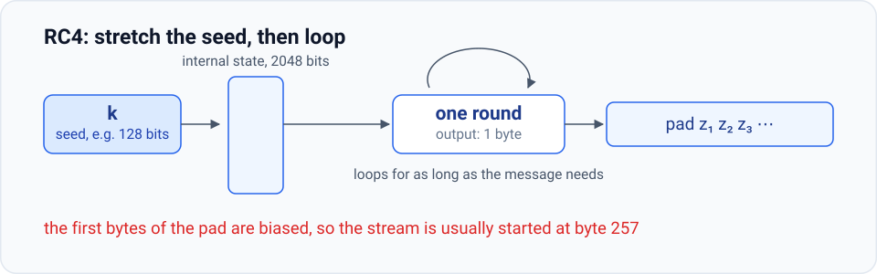
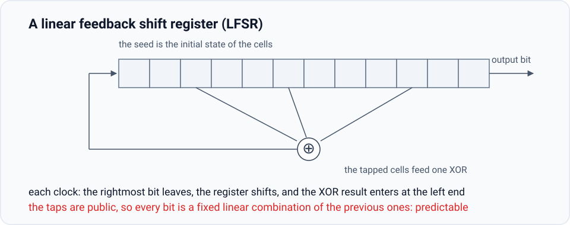
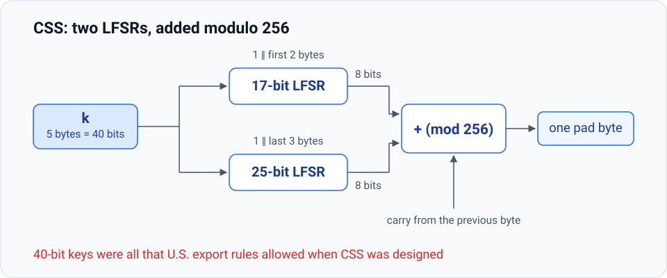
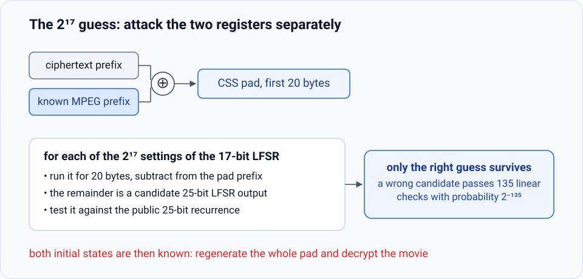
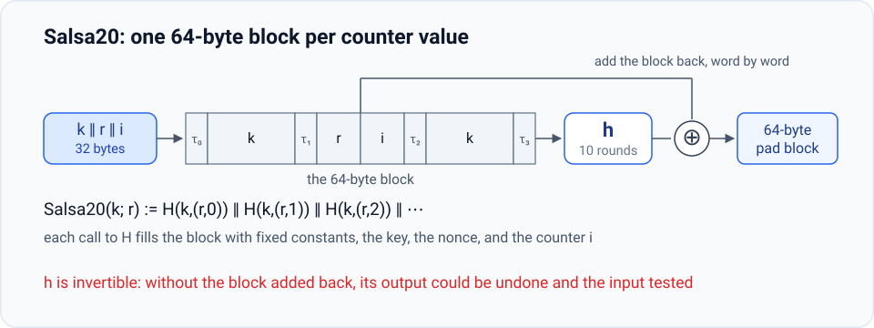
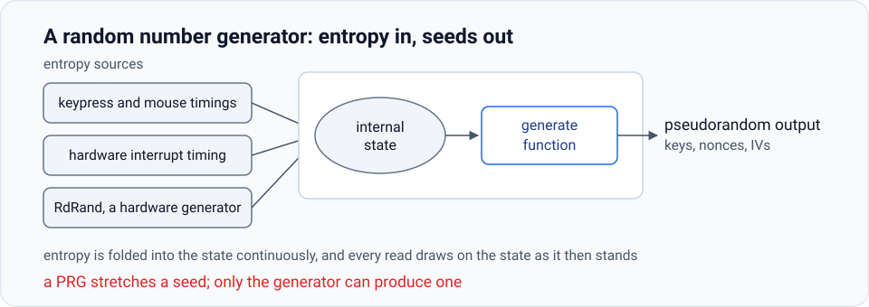

# 2.4 Real-World Stream Ciphers

Sections 2.2 and 2.3 reduced the security of a stream cipher to one property of its generator, unpredictability from every prefix, and one rule of usage: never restart the pad. This section looks at generators that have actually been deployed, two of them old enough that they are no longer recommended for new systems, and at the one input a generator cannot supply for itself, the seed.

## 2.4.1 RC4

**RC4** was designed by Ron Rivest in 1987 and built for software: every operation is a byte operation on a table that fits in a few kilobytes of memory, and the cipher runs on an 8-bit processor. It has two phases. A seed of variable length, 128 bits in the usual presentation, is expanded into 2048 bits of internal state. Then a loop runs for as long as the message requires, emitting one byte per round; the pad is whatever prefix of that stream the message needs.

<figure class="main-figure">
  
</figure>

RC4 carried a large share of HTTPS traffic, and for a period Google’s servers used it by default. It was also the cipher inside WEP, where, as Section 2.3.3 showed, it was used in exactly the way that destroys it. Three weaknesses found over the years explain why nothing new should use it.

**Bias in the initial output.** If the pad were random, its second byte would equal zero with probability $1/256$. For RC4 the probability is $2/256$. The consequence is immediate: the second plaintext byte is XORed with zero, and so travels in the clear, once every 128 messages instead of once every 256. Nothing is special about position two: the first and third bytes are biased as well, and in fact every one of the first 256 bytes deviates noticeably from uniform. The standard advice is to discard the first 256 bytes of output and use the stream from byte 257 onward.

**Bias in long output.** Count the occurrences of the two-byte pattern `00 00` in a long RC4 stream. A random string produces it with probability $1/256^2$ per position; RC4 produces it with probability

$$\frac{1}{256^2} + \frac{1}{256^3},$$

a relative excess of $1/256$, about $0.4\%$. The bias appears only after several gigabytes of output, but counting the pairs is a **distinguisher**: an efficient procedure that tells the generator’s output apart from a random string. It recovers neither the key nor the plaintext. Section 2.5 defines a secure generator by ruling out exactly such a procedure, so on the definition to come this bias alone is enough to fail.

**Related keys.** The attack that broke WEP is a property of RC4 itself, not of 802.11: when keys share most of their bits, as $\mathrm{IV} \,\|\, k$ does for consecutive counter values, the output leaks the long-term key.

None of these attacks recovers plaintext the way the two-time pad does. They show that the output can be told from a random string, and from a prefix of it the rest can be predicted, which is why new systems are pointed toward the generators of Section 2.4.5 rather than at RC4.

## 2.4.2 Linear feedback shift registers

The hardware side of the story is dominated by a mechanism that costs a handful of transistors. An **LFSR** (linear feedback shift register) is a row of $n$ cells, each holding one bit, together with a fixed set of **tap positions**. Each clock cycle outputs the bit at one end, shifts the register, and feeds into the other end the XOR of the bits at the taps. The seed is the initial state of the register.

<figure class="main-figure">
  
</figure>

The mechanism is exactly the object Section 2.2.3 forbids. The taps are public, so each output bit is a fixed linear combination of the preceding $n$ bits: $n$ consecutive bits of pad determine every bit after them. An LFSR alone is a predictable generator, and a stream cipher built on it falls to a known plaintext prefix, one header decrypting the whole message.

What hardware designers do instead is run several registers in parallel and mix their outputs with a non-linear operation. DVD encryption, the **Content Scrambling System** (CSS), adds the byte outputs of two registers; GSM voice encryption (A5/1 and A5/2) uses three; Bluetooth (E0) uses four. All of them are broken, and all of them are in silicon that cannot easily be replaced.

## 2.4.3 The CSS stream cipher

CSS was designed when U.S. export regulations allowed cryptographic hardware with keys of at most 40 bits, and the designers worked inside that budget. The seed is five bytes, split into the two register states as

$$1 \,\|\, s_1 \in \{0,1\}^{17}, \qquad 1 \,\|\, s_2 \in \{0,1\}^{25},$$

where $s_1$ is the first two bytes of the key and $s_2$ the last three: sixteen bits plus a leading 1 for the 17-bit register, twenty-four plus a leading 1 for the 25-bit register, all 40 key bits used. The leading 1 keeps either register from sitting in the all-zero state, from which a linear register would emit zeros forever.

<figure class="main-figure">
  
</figure>

Each register is clocked eight times to produce eight bits; the two eight-bit values, together with the carry from the previous round, are added modulo 256, and the sum is the pad byte. One byte per round, from a generator that needs almost no silicon.

## 2.4.4 Breaking CSS in $2^{17}$ steps

Exhaustive search over a 40-bit key costs $2^{40}$ work, already within reach of a determined attacker. The structure of CSS makes the search about $2^{23}$, roughly eight million, times cheaper.

<figure class="main-figure">
  
</figure>

The attack needs one fact about movies: MPEG video begins with a few dozen bytes of header that the encryption cannot hide, and twenty bytes suffice. XOR that known prefix into the ciphertext prefix and the result is the first twenty bytes of the CSS pad. From there:

1. Try all $2^{17} = 131{,}072$ initial states of the 17-bit register. For each guess, run the register twenty bytes and subtract its output from the pad prefix. (The carry from the previous byte perturbs each subtraction by at most one; trying both values doubles the work and changes nothing else.)
2. What remains is a candidate output of the 25-bit register. Its taps are public, so every bit past the first 25 is determined by its predecessors: a 160-bit candidate supplies $160 - 25 = 135$ such checks, and a string that did not come from the register passes all of them with probability $2^{-135}$.
3. Across all guesses the expected number of false survivors is $2^{17} \cdot 2^{-135} = 2^{-118}$. With overwhelming probability exactly one guess survives, and it is the correct one.

Both initial states are then known, and with them the key: the attacker regenerates the entire pad and decrypts the movie. Open-source tools do exactly this. The work is $2^{17}$ rather than $2^{40}$ because the two registers can be searched one at a time, and the cost is set by the smaller of them.

## 2.4.5 Nonces: reusing a key safely

The rule of Section 2.3.1, one key one pad, is expensive: every session would need a fresh key, delivered over a channel that must already be secure. The eSTREAM project, a European effort that concluded in 2008 and approved five stream ciphers, builds the exception into the generator. Its ciphers take two inputs, a seed and a **nonce** $r$ drawn from a nonce space $\mathcal{R}$:

$$G : \{0,1\}^s \times \mathcal{R} \to \{0,1\}^n, \qquad E(k, m; r) := m \oplus G(k, r).$$

::: theorem Definition (nonce)
A **nonce** is a value that never repeats for as long as the key is fixed. The requirement falls on the pair: $(k, r)$ is used at most once. The nonce is not secret; both parties need only agree on it and never reuse it.
:::

The nonce saves the trouble of moving to a new key every time: the key may be reused across sessions provided each use carries a fresh $r$, since it is the pair that determines the pad. This is the same discipline WEP broke. WEP’s IV is a nonce in all but the name, and it failed on both halves of the definition: 24 bits cycle after 16.7 million frames, and the counter was concatenated into the key instead of kept apart from it, so the pairs that did occur were related rather than independent. A nonce buys key reuse only when it is long enough not to wrap and chosen so that the pair is never repeated.

## 2.4.6 Salsa20

**Salsa20** shows the modern design. RC4 tunes every choice for software; the CSS registers are tuned for gates; Salsa20 is fast on an x86 and cheap in hardware. It takes a key of 128 or 256 bits and a 64-bit nonce, and produces up to $2^{73}$ bits of pad. The generator is one function $H$ of the key, the nonce, and a counter:

$$\text{Salsa20}(k; r) := H\bigl(k, (r, 0)\bigr) \,\|\, H\bigl(k, (r, 1)\bigr) \,\|\, H\bigl(k, (r, 2)\bigr) \,\|\, \cdots$$

Each call to $H$ returns a 64-byte block. The block is assembled by laying constants, key, nonce, and counter side by side; for the 128-bit key,

$$\tau_0 \,\|\, k \,\|\, \tau_1 \,\|\, r \,\|\, i \,\|\, \tau_2 \,\|\, k \,\|\, \tau_3, \qquad 4 + 16 + 4 + 8 + 8 + 4 + 16 + 4 = 64 \text{ bytes},$$

where the $\tau_j$ are fixed four-byte constants given in the specification, $r$ occupies eight bytes, and the counter $i$ eight more.

<figure class="main-figure">
  
  <figcaption class="image-caption">The counter is part of the block, so each value of $i$ gives an independent-looking 64-byte output; the 64-bit counter bounds the stream at $2^{64} \cdot 512 = 2^{73}$ bits.</figcaption>
</figure>

Inside $H$ an invertible function $h$ is applied ten times. $h$ is built from rotations, additions, and XORs on 32-bit words, chosen so that the x86 SSE2 instruction set runs it extremely fast. Ten rounds of an invertible function are themselves invertible, and an attacker who undoes them recovers the block, whose structure (two copies of the key, fixed constants in fixed positions) would confirm a guessed key. So the last step adds the input block back, word by word modulo $2^{32}$, and the sum is the output.

::: details Quiz: Is Salsa20 provably unpredictable?
No, and nothing else in this chapter is either. No pseudorandom generator is known whose security can be proved from a mathematical assumption of the sort Chapter 6 will use; the deployed candidates are analyzed, not proved. What is known about Salsa20 is negative and concrete: no published attack beats exhaustive search, and its security is said to be close to $2^{128}$. That is the strongest claim a practical generator currently carries, and it rests on analysis rather than on a theorem.
:::

## 2.4.7 Performance

The eSTREAM finalists are also the faster ciphers. The figures below are from the Crypto++ 5.6.0 benchmarks on a 2.2 GHz AMD Opteron:

| generator | speed (MB/s) | cycles per byte |
|---|---|---|
| RC4 | 126 | $\approx 17$ |
| Salsa20/12 | 643 | $\approx 3.4$ |
| Sosemanuk | 727 | $\approx 3.0$ |

RC4 is the slowest of the three despite being the simplest. It manipulates one byte at a time while the processor moves 64-bit words, so most of every cycle is unused: at 126 MB/s it spends about seventeen cycles per byte, against roughly three for the eSTREAM finalists. Salsa20/12 is the reduced-round variant used in the benchmark. Several hundred megabytes per second is more than enough to encrypt a movie in real time.

## 2.4.8 Where the seed comes from

Everything above assumes a uniformly random seed, and a PRG cannot supply one; it only stretches one. Systems get their randomness from a **random number generator** (RNG). Like a PRG an RNG outputs a sequence of bits, but it carries an extra interface: entropy is continuously folded into an internal state, and every read draws on the state as it then stands.

<figure class="main-figure">
  
</figure>

Linux exposes one as `/dev/random`. Its entropy is the irregular behavior of a working machine: the timing between keypresses and mouse movements, the spacing of hardware interrupts. The input itself is never used, only its timing, so that one user’s keystrokes cannot be read back out of the random device by another process. Hardware generators add volume: the RdRand instruction, introduced with Intel’s Ivy Bridge family in 2012, delivers raw bits at roughly 3 Gb/s; those bits are conditioned to remove bias and mixed into the pool as one source among several, not treated as a replacement for the others, so that a silent hardware failure cannot by itself compromise the keys. Standardization bodies publish approved constructions of the same shape, NIST SP 800-90 among them.

The chain is now complete in one direction and still open in the other: entropy gives a seed, a generator stretches it, the stretched pad masks the message. What Sections 2.2 through 2.4 have not given is a definition sharp enough to say when a generator has done its job, or a proof that a stream cipher built from one keeps a message secret. Those are the work of Sections 2.5 and 2.6.
